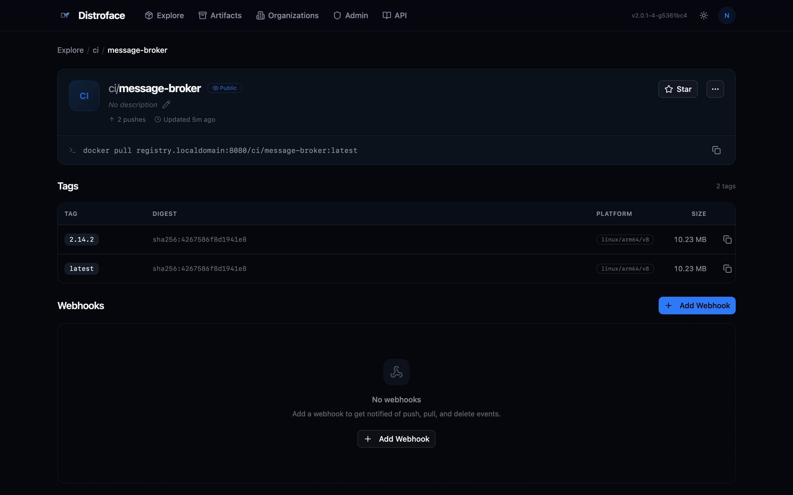

<div align="center">
  <p><b>DistroFace</b><br></p>
  <picture>
    <source media="(prefers-color-scheme: dark)" srcset="web/distroface/static/icon.png">
    
  </picture>
  <p><b>Blob Distribution & Storage</b><br></p>
</div>



## Quickstart

```bash
docker run -p 8080:8080 -v distroface:/app/data nickheyer/distroface:latest
```

```bash
docker login localhost:8080
docker tag alpine localhost:8080/myteam/alpine
docker push localhost:8080/myteam/alpine
```

```bash
git clone http://localhost:8080/myteam/app        # the same ns/name is one project
git clone git@localhost:myteam/app.git
```

## Documentation

> [!TIP]
> Read docs at [nickheyer.github.io/distroface](https://nickheyer.github.io/distroface/).

> [!CAUTION]
> These docs are subject to change and mostly AI generated (with amendments and supervision). Please submit an issue if you discover any innaccuracies.

Getting started

- Installation: [docs/getting-started/installation.md](docs/getting-started/installation.md)
- Configuration: [docs/getting-started/configuration.md](docs/getting-started/configuration.md)
- Database: [docs/getting-started/database.md](docs/getting-started/database.md)
- Cache: [docs/getting-started/cache.md](docs/getting-started/cache.md)
- Logging and profiling: [docs/getting-started/logging-and-profiling.md](docs/getting-started/logging-and-profiling.md)
- Building and development: [docs/getting-started/building.md](docs/getting-started/building.md)

Administration

- Settings: [docs/administration/settings.md](docs/administration/settings.md)
- Users and roles: [docs/administration/users-and-roles.md](docs/administration/users-and-roles.md)
- OIDC: [docs/administration/oidc.md](docs/administration/oidc.md)
- Organizations: [docs/administration/organizations.md](docs/administration/organizations.md)
- Tokens: [docs/administration/tokens.md](docs/administration/tokens.md)
- TLS: [docs/administration/tls.md](docs/administration/tls.md)
- ACME: [docs/administration/acme.md](docs/administration/acme.md)
- Certificate authority: [docs/administration/certificate-authority.md](docs/administration/certificate-authority.md)
- Portals: [docs/administration/portals.md](docs/administration/portals.md)
- Mail: [docs/administration/mail.md](docs/administration/mail.md)
- Audit: [docs/administration/audit.md](docs/administration/audit.md)
- Health: [docs/administration/health.md](docs/administration/health.md)

Registry

- Overview: [docs/registry/overview.md](docs/registry/overview.md)
- Storage: [docs/registry/storage.md](docs/registry/storage.md)
- Manifests: [docs/registry/manifests.md](docs/registry/manifests.md)
- Garbage collection: [docs/registry/garbage-collection.md](docs/registry/garbage-collection.md)

Artifacts

- Repositories: [docs/artifacts/repositories.md](docs/artifacts/repositories.md)
- Upload and download: [docs/artifacts/upload-and-download.md](docs/artifacts/upload-and-download.md)
- Search and properties: [docs/artifacts/search-and-properties.md](docs/artifacts/search-and-properties.md)
- Retention: [docs/artifacts/retention.md](docs/artifacts/retention.md)
- v1 API: [docs/artifacts/v1-api.md](docs/artifacts/v1-api.md)

Git

- Repositories: [docs/git/repositories.md](docs/git/repositories.md)
- Cloning: [docs/git/cloning.md](docs/git/cloning.md)
- LFS: [docs/git/lfs.md](docs/git/lfs.md)
- Branches and protection: [docs/git/branches.md](docs/git/branches.md)
- Code: [docs/git/code.md](docs/git/code.md)
- Signing: [docs/git/signing.md](docs/git/signing.md)
- Maintenance: [docs/git/maintenance.md](docs/git/maintenance.md)
- Linked repositories: [docs/git/linked-repositories.md](docs/git/linked-repositories.md)
- Issues: [docs/git/issues.md](docs/git/issues.md)
- Pull requests: [docs/git/pull-requests.md](docs/git/pull-requests.md)
- Releases: [docs/git/releases.md](docs/git/releases.md)
- Wiki: [docs/git/wiki.md](docs/git/wiki.md)
- Projects: [docs/git/projects.md](docs/git/projects.md)
- Notifications: [docs/git/notifications.md](docs/git/notifications.md)

Mirrors and webhooks

- Mirrors and imports: [docs/mirrors.md](docs/mirrors.md)
- Webhooks: [docs/webhooks.md](docs/webhooks.md)

Actions

- Overview: [docs/actions/overview.md](docs/actions/overview.md)
- Workflows: [docs/actions/workflows.md](docs/actions/workflows.md)
- Runners: [docs/actions/runners.md](docs/actions/runners.md)
- Secrets and variables: [docs/actions/secrets-and-variables.md](docs/actions/secrets-and-variables.md)
- Artifacts and cache: [docs/actions/artifacts-and-cache.md](docs/actions/artifacts-and-cache.md)
- GitHub API: [docs/actions/github-api.md](docs/actions/github-api.md)

Agents

- Overview: [docs/agents/overview.md](docs/agents/overview.md)
- Connectors: [docs/agents/connectors.md](docs/agents/connectors.md)
- Definitions: [docs/agents/definitions.md](docs/agents/definitions.md)
- Sessions: [docs/agents/sessions.md](docs/agents/sessions.md)

API

- Overview: [docs/api/overview.md](docs/api/overview.md)
- Services: [docs/api/services.md](docs/api/services.md)

CLI

- Overview: [docs/cli/overview.md](docs/cli/overview.md)
- Reference: [docs/cli/reference.md](docs/cli/reference.md)

Migration

- Migrating from v1: [docs/migration.md](docs/migration.md)

MIT, see [LICENSE](LICENSE).
