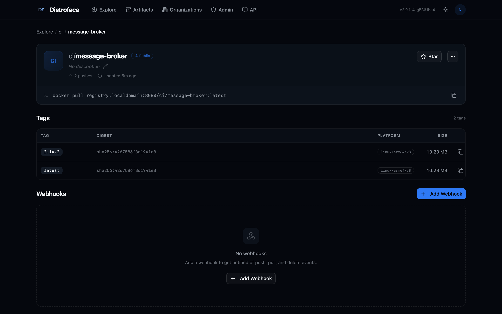
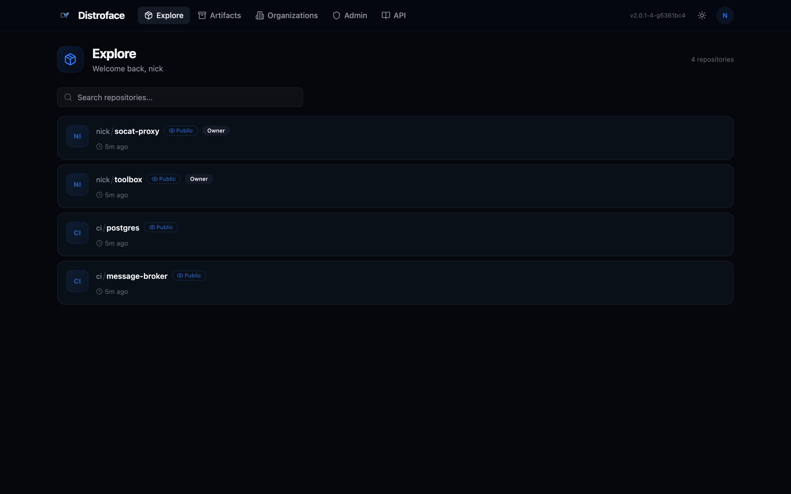
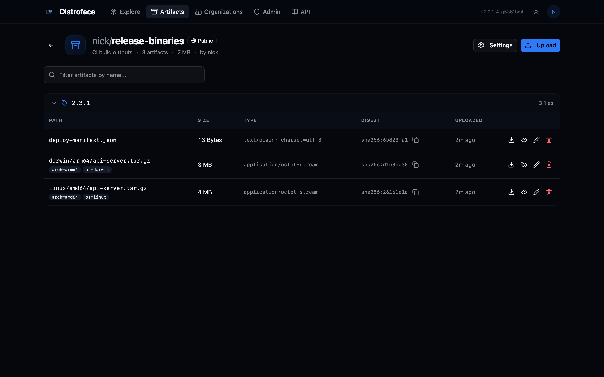
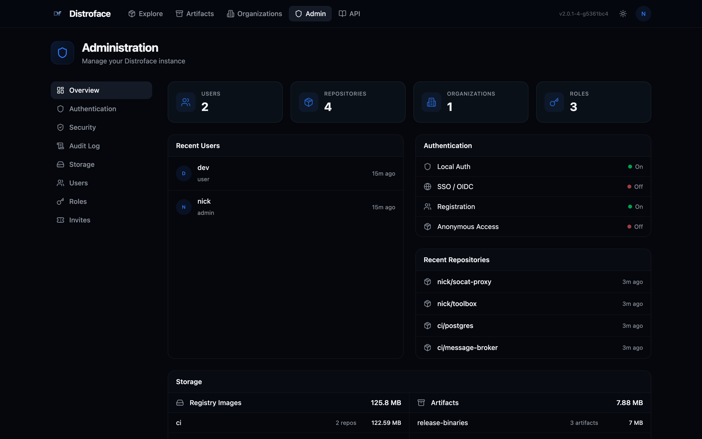
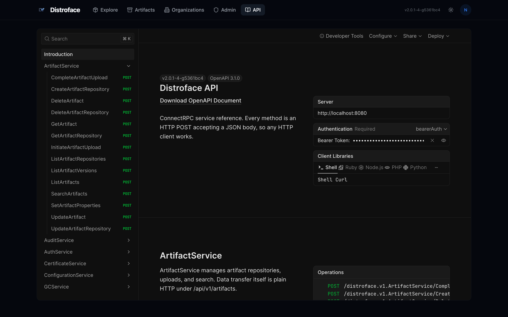

<div align="center">
  <p><b>DistroFace</b><br></p>
  <picture>
    <source media="(prefers-color-scheme: dark)" srcset="web/distroface/static/icon.png">
    
  </picture>
  <p><b>Blob Distribution & Storage</b><br></p>
</div>



## Run

```bash
docker run -p 8080:8080 -v distroface:/app/data nickheyer/distroface:latest
```

Open http://localhost:8080 and create an account, first one is admin. Git over ssh is off until an admin enables it under Admin, Git. The port defaults to 22, the settings page probes it before saving, and the container publishes it with `-p 22:22`. When 22 is taken on the host, publish another one and tell clone urls about it:

```bash
docker run -p 8080:8080 -p 2222:22 -e DISTROFACE_SETTINGS_JSON='{"git":{"sshEnabled":true,"sshPublicHost":"localhost:2222"}}' -v distroface:/app/data nickheyer/distroface:latest
```

```bash
docker login localhost:8080
docker tag alpine localhost:8080/myteam/alpine
docker push localhost:8080/myteam/alpine
```

```bash
git clone http://localhost:8080/myteam/app        # the same ns/name is one project
git clone git@localhost:myteam/app.git
```

## Inside

- Git repositories served in process by go-git over smart http and ssh, with LFS, branch protection, code browsing and editing, issues, pull requests with reviews, releases, wiki, projects, notifications, mirrors, imports, and Actions
- Agents: model driven reviewers, coders, assistants, and triage bots per repository, org, or instance, speaking to any OpenAI compatible, Ollama, Anthropic, Azure, Gemini, or Bedrock endpoint through opaque connectors, with mentions, assignments, review requests, approval gates, budgets, transcripts, and commands on your own runners
- OCI registry under `/v2/`, namespaced per user and org
- Artifact repos: versioned files, key=value properties, query-based download
- One project per `ns/name`: images and artifacts named after a git repo link to it, share access, and show up on its releases
- Org portals: A proxied interface for org resources, scoped to org members.
- Local accounts and OIDC (Keycloak / Authelia / Entra recipes in [`oidc/`](oidc))
- RBAC, personal access tokens, invites, audit log
- Webhooks on push, pull, and delete
- In-app TLS with ACME auto-cert issuance, per-hostname certs via SNI
- Registry GC and artifact retention reapers
- Rate limits and login lockout

|                                    |                                      |
| ---------------------------------- | ------------------------------------ |
|  |  |
|    |        |

## API

ConnectRPC, every method is a `POST` with a JSON body, so any HTTP client works. Interactive reference with OpenAPI download ships in the UI at `/docs/api`.

## CLI

Static `dfcli` binaries for linux/mac/windows on the [releases page](https://github.com/nickheyer/distroface/releases), or `make dfcli`.

```bash
dfcli login
dfcli artifact upload builds ./api-server.tar.gz -v 2.3.1 --property os=linux
dfcli artifact download builds -v 2.3.1 --property os=linux -o api-server.tar.gz
git config --global credential.helper "dfcli git credential"   # passwordless http pushes
dfcli repo create myteam/app --private && dfcli git clone myteam/app
dfcli pr create myteam/app --base main --head feature --title "Feature"
dfcli release upload myteam/app v1.2.3 ./dist/*
dfcli runner register --server https://df.example.com --token <t> --name ci && dfcli runner start
```

The server can run jobs itself. Turn the built in runner on under Admin, Actions, give the process the docker socket, and bind the data dir at the same path on the host and in the container, jobs are sibling containers and the daemon mounts job directories by host path. A runner named `builtin` then serves the configured labels at the instance scope. The socket makes the server root on its host, so keep it to development and small instances and use `dfcli runner` on a separate machine for anything shared.

Agent sessions that run commands open one job per session, the command workspace. It checks the working branch out once, writes the session's uncommitted edits in front of each command, and stays open until the session ends, so installed dependencies survive between commands.

Repos are addressed as `[namespace/]name`, bare names resolve to your own namespace first, then the unique visible match, qualify the name if it's ambiguous.

## Config

One `config.yaml`, every default is in [`config.example.yaml`](config.example.yaml). Any key works as a `DISTROFACE_*` env var. Seed users and orgs on first boot with the `bootstrap:` block.

## TLS and ACME

The main listener (`server.port`, default 8080) answers TLS and cleartext on the same port and picks the certificate by SNI. Nothing is served over TLS until a certificate source resolves, so a fresh install is reached over plain `http://` and stays reachable that way until a certificate is ready, even in HTTPS only mode. Everything below lives under Admin, Network security and Admin, Certificate authority, and can be seeded on first boot through the `settings:` block or `DISTROFACE_SETTINGS_JSON`. The status line under the hostname on Network security reports why a certificate is not issued yet and what to do next.

### Public certificate from Let's Encrypt

The CA validates on port 80 (http-01) and port 443 (tls-alpn-01), nothing else. Publish the main port as 443 and the challenge port as 80, keep 8080 for the cleartext setup session:

```bash
docker run -p 80:80 -p 443:8080 -p 8080:8080 -v distroface:/app/data nickheyer/distroface:latest
```

1. Point DNS at the host, open `http://registry.example.com:8080` and sign in as the admin.
2. Admin, Network security: set the public hostname to `registry.example.com` (no port when clients use 443).
3. ACME client: set the account email, leave the directory empty for Let's Encrypt, keep the challenge port at 80, then turn on automatic issuance. Use `https://acme-staging-v02.api.letsencrypt.org/directory` while wiring ports, failed validations count against the production limits.
4. Certificate source: pick ACME and press Issue certificate. The first https handshake also issues.
5. Listener mode: HTTPS only once the status reads https, redirects start when the certificate is ready.

Saves that cannot work are refused with the fix in the message: ACME without an email, ACME as the source while issuance is off or the hostname is `localhost` or an ip, a challenge port equal to the main or ssh port, a directory url pointing at this instance. A public hostname with a port such as `registry.example.com:8443` is fine for clients, the CA still needs 80 or 443 to reach the instance.

The same deployment as config:

```yaml
settings:
  server: { public_hostname: "registry.example.com" }
  tls: { mode: "TLS_MODE_HTTPS_ONLY", primary_source: "CERT_SOURCE_ACME" }
  acme: { enabled: true, email: "ops@example.com", challenge_port: "80" }
```

### Org portal hostname with an ACME certificate

Needs automatic issuance on at the instance (step 3 above) and DNS for the portal hostname pointing at the host. The org admin creates the portal under the org's Portals page with the hostname and picks ACME as the certificate source. The hostname registers itself as a certificate domain, with Require approval on under Admin, Portals it waits there for a system admin. Issue from the org's Certificates page or let the first https handshake do it. Validation hits the portal hostname on 80 or 443, a portal on another port therefore relies on the http-01 listener on port 80.

### Internal CA with the built in ACME server

For runners and other internal machines that should trust one root.

1. Admin, Certificate authority: generate the instance root. Clients fetch it from `https://registry.example.com/.well-known/distroface/ca.pem` or run `dfcli trust install --server https://registry.example.com`.
2. Turn on the built in ACME server, it refuses to start without the root.
3. Add every hostname that may enroll under Allowed hostnames. The primary hostname and ACME portal hostnames are allowed implicitly, anything else is rejected with `host not allowed`.
4. Point the client at `https://registry.example.com/acme/directory` with the root as its CA bundle. Until the primary hostname serves TLS the directory also answers at `http://registry.example.com:8080/acme/directory`. The instance validates http-01 on port 80 or tls-alpn-01 on port 443 of the client, so the client must be reachable from the instance on one of those.

```bash
LEGO_CA_CERTIFICATES=distroface-ca.pem lego --server https://registry.example.com/acme/directory \
  --email ops@example.com --domains runner1.internal --http run
```

To serve the primary hostname or a portal from the same root pick the Instance CA or Org CA certificate source instead, an instance cannot enroll with its own directory.

## Hack

```bash
make deps   # go, npm, buf
make dev    # backend :8080 + vite frontend :5173
make build  # single binary, UI embedded
```

MIT, see [LICENSE](LICENSE).
